# How this game was made

**Status (2026-10-29): a first draft for Michael to read (#560), not yet for players or press.** It is drawn from the record: Michael's own messages to the agents (every one kept in the session transcripts), the pictures sent with them, both prototype repositories, the commit history, the pull requests and their reviews, and `docs/02-decisions.md`. Where the record is unclear or disagrees with itself, the question went to Michael instead of into this page; the open ones are on the pull request. Dates are Michael's local time (US Central). Quotes are Michael's, verbatim, typos and all. The game's name is still a working title.

A reference, kept true in place and added to as the game grows: a new chapter goes at the end, the numbers are refreshed, and nothing is struck.

---

## The short version

Cozy Medieval Zombies is one person's game. Michael designs it, plays it, and rules on it; AI agents write the code and draw the art. In Michael's words (2026-10-28):

> "I had this game idea in my head, I just needed the tools to get it made. ... So I am doing exactly the normal dev process - design, test, iterate - just with AI doing the coding and art (for now). I'm neither the main programmer or artist, but am serving more of a "creative director" role for the project."

The idea is older than any code: a medieval zombie game with RPG leanings, drawn first as two pieces of concept art. Two small prototypes in September 2026 each proved half of it and failed at the other half. This game began on 8 October 2026 as the marriage of the two, and in its first three weeks it went from a placeholder test map to a drawn autumn village that friends play together in one world, with second storeys, round towers, cliffs, and caves.

Every ruling along the way is logged with its reason, most of them in Michael's own words. This page follows the big ones.

---

## Before any code: a knight and a zombie

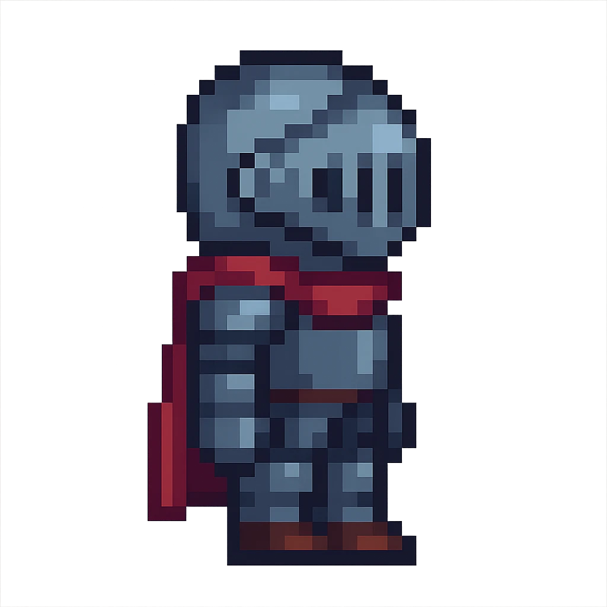
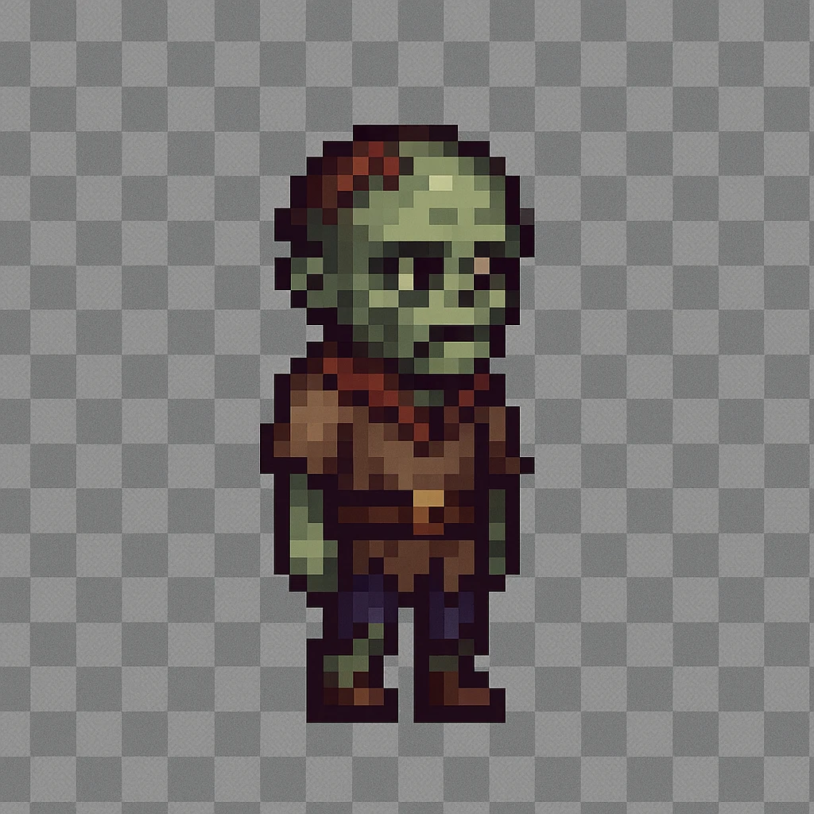

Months before the first prototype, Michael worked with another AI (Michael thinks it was Google Gemini) on two pieces of concept art: a knight in a red cloak and a zombie villager. They are the only pixel-art characters from that time.

> "The knight was something I did a bunch of iterations of to get it just like in my head. The zombie villager was a one-shot after I left a lengthy description and I find that one gripping." (2026-10-29)

The game in mind then was "a medieval zombie game that is RPG focused, running around killing zombie villagers, talking to NPCs, looting medieval scenery". Michael shared the two pictures with this game's agents on its third day, "as ideation", to set the chunky, big-headed look of its people.

---

## The first prototype: a side-scroller (7 to 9 September 2026)

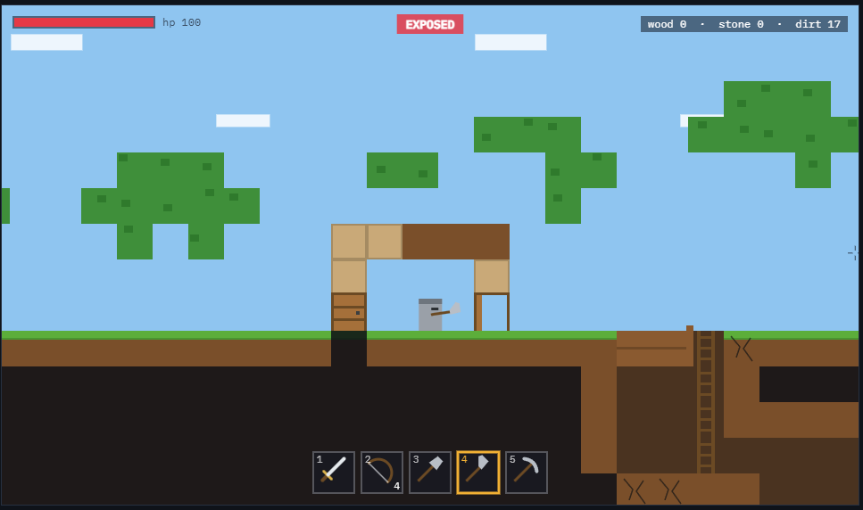

**Medieval Zombie Survival** (Michael calls it "medieval zombies") began at about four in the morning on 7 September as a single web page: a box that ran and jumped, a sword, and a bow. The bow was the first thing designed with care, a delayed hitscan, "think bow and arrow instead of gun", and it has stayed Michael's favourite weapon in everything since. Twenty minutes later, with the box re-coloured as a grey knight among green zombies, came the first screenshot of the whole story, with three words.

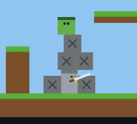

> "I live here now." (2026-09-07)

Over three days it grew into a 2D survival game, "Terraria's world, Zomboid's stakes": digging and mining, building, an inventory where everything is an item, finite arrows, and doors and windows the dead could break. Its best idea was sight: a room you sealed hid you completely, because the game flood-filled the air around you.

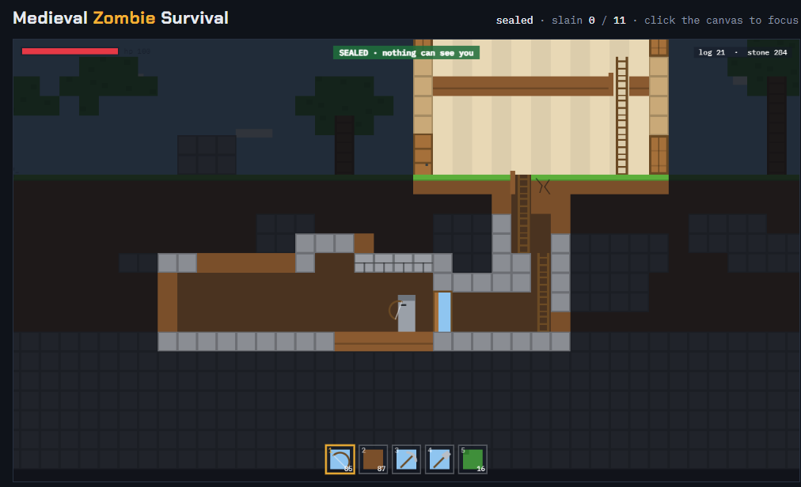

> "Trapdoor works and triggering LOS within a house (after close trapdoor, downstairs now no vision) is an amazing outcome I didn't even specifically ask for." (2026-09-07)

> "Also we definitely can't get rid of the Minecraft digging because it is for sure the most fun part." (2026-09-09)

It was fun, and it was the wrong shape. Looking back:

> "I wanted 2d because it was easier and cheaper. But it made me realize 2d zomboid really does not work because you need 3 dimensions to outfox slow Romero zombies in a satisfying way." (2026-10-29)

It is still playable at [michaeldippold.github.io/medieval-zombie-survival](https://michaeldippold.github.io/medieval-zombie-survival/).

---

## The second prototype: dioramas (14 to 17 September 2026)

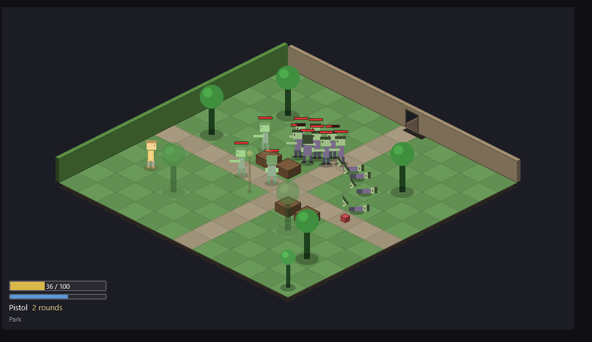
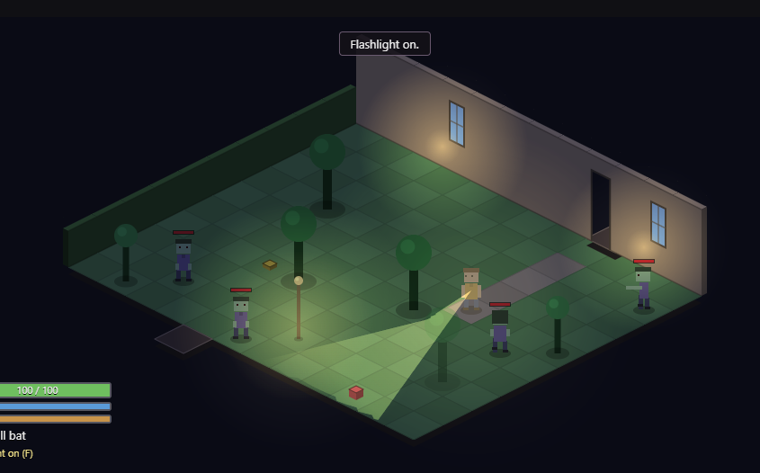

A week later Michael tried the other half. **Cozy Zombie Game** was modern and isometric, "Project Zomboid boiled down to its essentials, wearing a cozy game's clothes". The world was a map of little diorama sets, a house, its yard, a street, a shop, a park, joined by doors that worked like teleport pads.

The doors were the first thing Michael drew for an agent. Walking out of the house put you in the same corner of the yard you had walked in from, so your momentum carried you straight back inside:

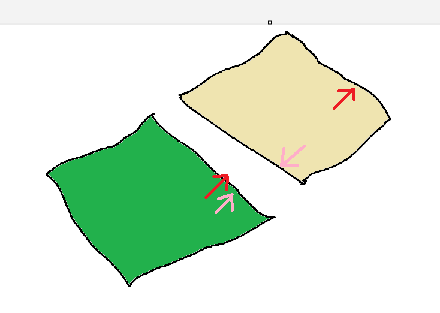

> "So the first thing you naturally do when you exit is press yourself into the corner to go back in. It's jarring. ... I have attached a crudely drawn image." (2026-09-14)

In four days it built most of what a zombie game needs: dead that kept moving when you could not see them, searchable bodies, a grid inventory, hunger and thirst, death that turned you into one of them, and melee Michael could "micro" by dipping in and out. Above all it built light: night as moonlight, a flashlight the dead reacted to, rooms lit or dark, and shadows.

> "I think this current version is the sweet spot. The circled corner is genuinely dark but not completely unseeable." (2026-09-17)

Then the dioramas showed their limit. A set only drew what was inside it, so the back walls of the starting house were fake:

> "so you have this entry point that makes no spatial sense and is functionally just a zombie spawn portal in your base. And not being able to meaningfully "look out" windows sucks, especially now that I know what is possible with lighting and shadows on canvas." (2026-10-08)

And Michael missed swords. Guns felt "way too powerful in the game and are hard to balance". It is still playable at [michaeldippold.github.io/cozy-zombie-game](https://michaeldippold.github.io/cozy-zombie-game/).

---

## Starting over (8 October 2026)

In the small hours of 8 October, sitting in the diorama game's folder to plan its next step, Michael stopped:

> "Neither this game,  nor its neighbor (ironically called medieval zombies, it's medieval zomboid by way of Minecraft from the perspective of Terreria) can give you that moving from building to building fluidly experience."

> "Wait are we overthinking this? ... If the browser CAN do this, maybe I ought to test it. ... We could call it cozy-medieval-zombies and marry the two demos (medieval 2d minecraft zombies) and (modern isometric habbo style cozy but with zombies)."

That night set the first law of the new game: **one continuous map, no cut between inside and outside.** It also planted others. Zomboid's water and power shutoffs went ("Fire is everything, and every natural resource is so important"). Farming went to the centre ("if it doesn't work the game probably won't"). And villagers came in, for a reason any Zomboid player knows:

> "it's lonely as fuck once the tv goes out in single player."

> "My point is don't let me cripple the NPCs because I am worried about the dang browser."

The diorama game gave the new one its bones: about twenty modules were copied across with a header naming where they came from (the isometric maths, the game loop, the inventory, the pathfinding, the player and the dead), the combat was ported, and the light was rewritten in its shape. The side-scroller gave rulings rather than code: medieval and no guns, everything is an item, the bow. In Michael's words: "You can draw a fairly direct line between that second diorama demo and the chunked world."

---

## It becomes a Place (9 to 11 October)

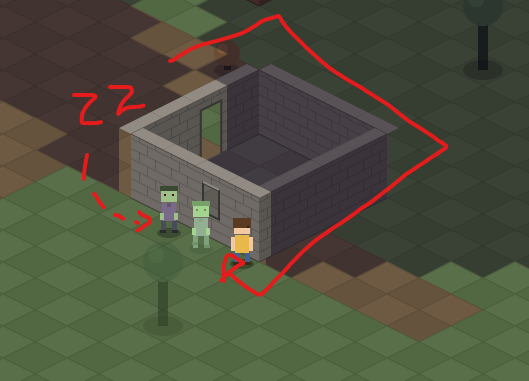

The first build of the continuous map ran the next night. Michael sprinted out of town "like a wanted man" to see whether it would break, and it kept loading grass. A screenshot marked up in red showed how the dead should come round a house. Then a test of their memory:

> "Well testing zombie memory is enough to tell me this is better than either my medieval sidescroller or my modern diorama/node game. It feels like playing Zomboid now"

> "With the new art it's not just a test space, it's a Place." (2026-10-09)

The mood came the same night: "When I get real art I want it to look like a place where Halloween kinda never ends", and "the cozy version of this game is aggressively fall colored." So did the engine. The first lighting fought back ("this is why people use game engines I assume lol"), and Michael chose to have the renderer written in raw WebGL rather than with a library:

> "The thing about tools like PixiJS is they were written to simplify this stuff for humans to write. With you as my coding expert, there's very little cost to just writing in raw webGL in my opinion." (2026-10-09)

> "This is amazing, I was not sure I actually wanted to move on earlier but was willing to accept it, THIS is the right system." (2026-10-09)

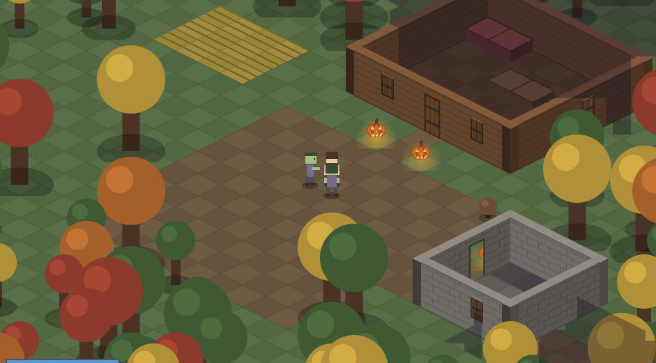

This is the first map in those days, all placeholder art drawn by code at boot. Models from the diorama game are still visible in it.

### The night the art arrived

On 10 October Michael asked Claude Design for a sheet of trees. The difference was immediate.

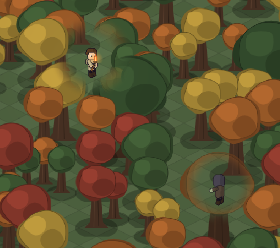
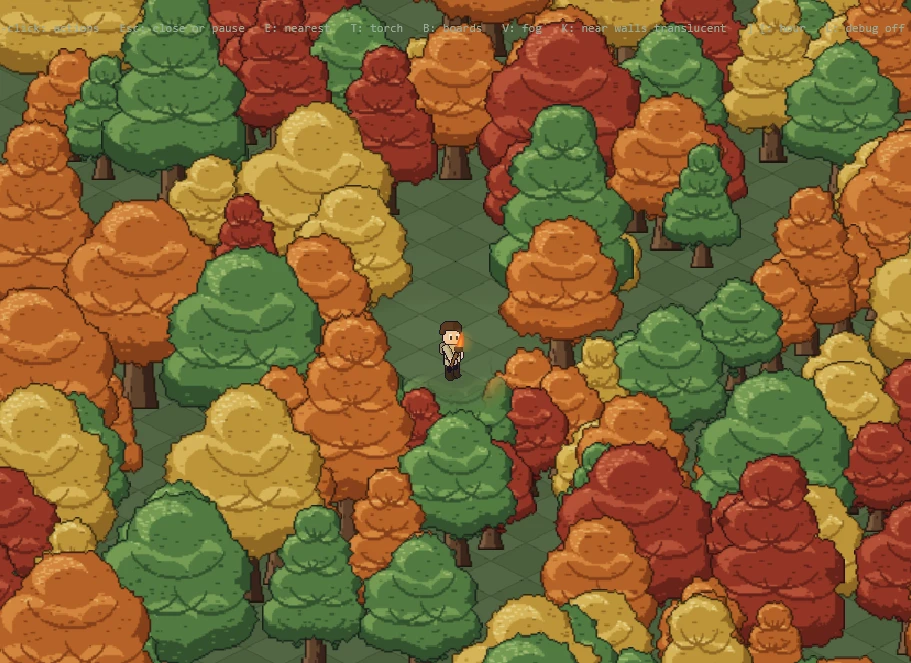

> "It's honestly even better than expected. It looks amazing." (2026-10-10)

> "As I recall trees were the thing that made me go "oh, dev art can actually look great"." (2026-10-15)

That night Michael worked through to six in the morning, then posted two screenshots of the same village with five words.

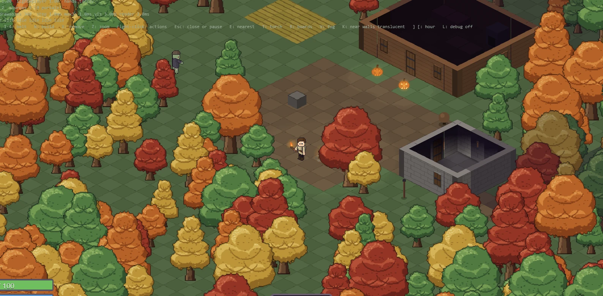
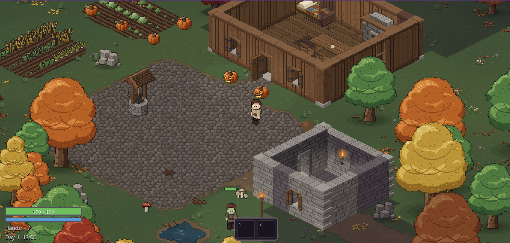

> "For the record, start and finish tonight." (2026-10-11)

The same night gave the game one of its odder laws. Mushrooms, rocks, and crops would be gathered someday, but nothing was built for them yet, so Michael asked for each to give a little wiggle when clicked, "like an in-world to do":

> "Perfect, and fuck it, let's just make this a law in this game for now. If it's in this category of items that are going to have a gathering type actions, clicking wobbles it. And the black outline."

It is still a law. Anything you will one day gather sways when you click it or walk through it, and wears a dark outline.

---

## The goobers (9 to 12 October)

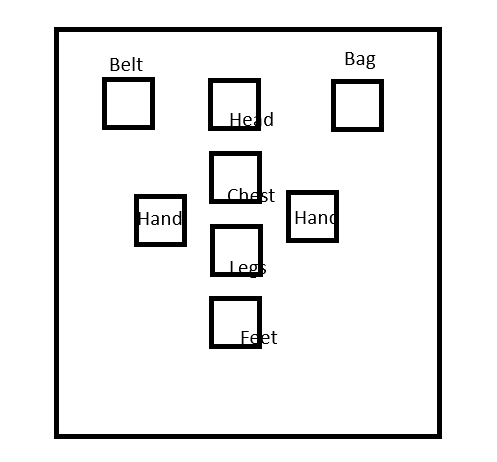

The people got a body: a rig of parts drawn at boot, in eight facings. Michael drew the character screen's layout ("I added a terrible drawing and I got tired of sizing font so I just stopped, but you get the idea") and went over the figure pixel by pixel with an art agent, in notes like these:

> "He kinda looks like a scared little frog right now."

> "that haircut has some crazy monk energy."

> "It keeps drawing its arms as two baguettes pasted onto the shoulder joint"

Michael asked for a tool to paint the art by hand, and half an hour later: "I was able to open a short, paint it all purple on all rotations, reload the page, and it works in game." The people, Michael ruled, are not men or women but goobers: "They're not humans they are little goobers, who come in zombie form too": the same small body for everyone, the dead included, with the game's text saying they and them.

When an art agent redrew the body, Michael tried the redraw, set it beside the old rig, and kept the old one, fixed pixel by pixel:

> "Well Claude, I tried in the real game, tested all 8 angles holding nothing, main hand only, and dual wield, always making sure I saw movement with all 8 facings, and I cannot find a single pixel that looks out of place. This is definitely the cleanest version of the base model we've ever had. I'd say we have a body!" (2026-10-12)

Combat came the same days: the sword, the spear and shield ("This makes spear and shield a special boy and I am here for it"), and the bow, built "super carefully" because it is "always my favorite weapon in these games and I am picky". The bleed was tuned by counting it out loud in Mississippis. And the game passed a test nobody had set:

> "The best thing I can tell you about the game feeling like a real game now is that I had it on my main monitor and decided to go refill my water bottle, and because of OSRS Ironman and HC wow and etc I checked to see if my character was safe before standing up." (2026-10-12)

On 12 October Michael decided this one would be finished: "I intend to fully finish this one."

---

## Friends in one world (11 to 15 October)

Michael plays with a brother, and Zomboid's sync troubles had kept the two of them apart in its fights. The first ask was whether multiplayer was possible at all, on one condition: "If we CAN add another player but the sync issues would kill the fun, then kill the idea also." The next night Michael wanted the whole thing ("The simplest version would almost not be worth doing"), and on 13 October two browsers joined one world through the public site.

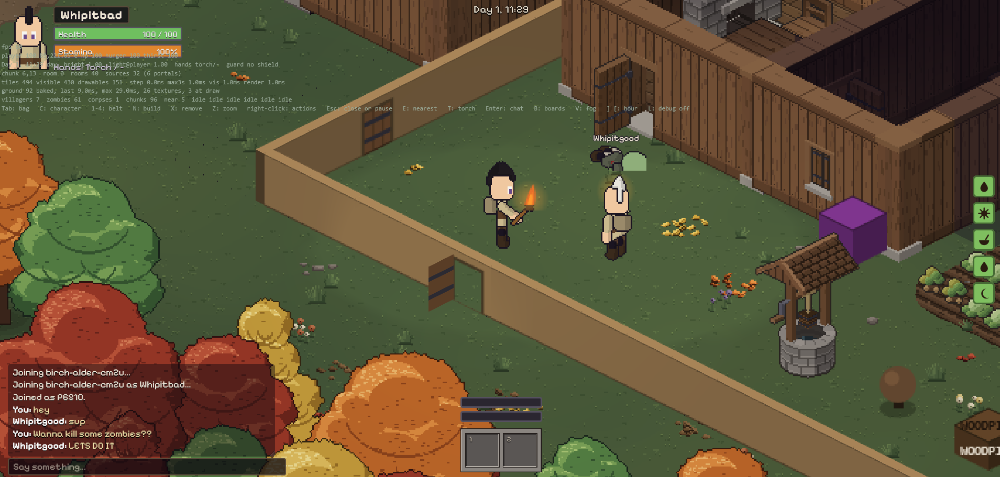

> "Well, I am finally able to load from the github sites and get a real join game, as well as us talking to one another, both speech bubbles and in text box." (2026-10-13)

That evening two laws were written that still shape every change.

**Multiplayer is live: every change is built for a guest in the same commit.**

> "Make a note in at least two places if possible that now that MP is live, every single new addition or change must account for it. I do not want to let it lag behind by a week and then have to do a shitload of catch up work" (2026-10-13)

**Never harder on a clock.** No world decay, no scheduled horde, no danger that grows with the days; every rise in danger is one a player chose. The reason is the brother:

> "never harder on a calendar. ... If you hadn't guessed, A is me and B is my brother, and I have to STOP PLAYING games I love to wait for him because the penalty of one player playing without the other is relatively high. I want every escalation in difficulty to be one you choose"

> "I went to the bog, and accidentally brought some bog danger home with me. If you can't tell I feel strongly about this." (2026-10-13)

The same night Michael sketched the arc the game still follows: "I like stories where everything is normal until it's isn't." A cosy farming start; then the dead; then regions beyond the valley, each spookier than the last, gated by bosses; and at the end, "your severed demon head" hung "as a decoration in The Valley where your cozy farming start happened."

Worlds moved onto a server so a friend could join at any hour. The night of 14 October brought the wiki, on the model of the Old School RuneScape wiki, and with it the second rule of shipping:

> "100%! This thing is not worth building if it's going to immediately fall behind." (2026-10-14)

> "Very funny, I just learned something new about my own game from your wiki." (2026-10-14)

Michael added a Verify button, to stamp each page once it is checked by hand. And at half past two in the morning on 15 October came a death in the game:

> "I almost died organizing my bags because I forgot zombie aggro was on by default and with 100 around they just kept finding me. I dived back inside finally and got the door shut but I died to the bleeds. So I respawned in the next room over, looted my own corpse, and now I can play lol."

> "That's a whole game loop proven"

---

## A studio of agents (14 to 16 October)

Until then Michael had carried every message between the agents by hand, pasting one's report into the other. On the night of 14 October Michael asked for the process "a real game studio" would use, on GitHub, and invented its two roles: one **Primary**, the technical lead who reviews and merges everything ("the buck stops here before it stops at me"), and any number of **Secondaries** who build on branches. Every agent asks Michael its role before it changes anything. Every ruling goes into the decisions log with its reason. Every change is a pull request, reviewed as a rule by an agent that had no part in it.

The studio's first days were rough, and Michael said so: "Okay I am having like an epically bad day ... I need a win today." The win was fire. And a bug hit while playing became a law that day: with the bag open you could not cast, so

> "The only thing that should stop you from playing the game and make you safe is the pause menu." (2026-10-15)

---

## The shape of the game (16 to 20 October)

The evening of 16 October was the big design night. Michael wrote it out in one long message and asked the agent to summarise it back: "Just so I understand what you read from that haha". From it:

- **Danger that follows you home.** "each time you opt to step out of the valley and into a new area, some of the danger follows you home."
- **A cosy player is welcome.** "someone who pays for the game with the intention of it just being another harvest moon / stardew valley hangout and do chores cozy game should get that experience, plus or minus zombies".
- **It must not be easy.** "if you can run through the whole game's progression systems and defeat all of the bosses in just a few hours, then I have failed".
- **The regions start from a mood.** "dark fantasy and heavy metal are the oldest of friends." One is a vampire church out of *Midnight Mass*, "one of my favorite stills from any piece of horror ever": "This alone would be worth making a game about."

Two laws came out of the same night. **Nobody climbs through a window**, player or dead:

> "Let's make this a law, we are going to remove this mechanic any everyone's ability to trigger it. It's not fun, and this is not zomboid, you are not clearing entire new blocks every day. Feels good, that was bugging me." (2026-10-16)

And **a sealed room is safe, and it is a cell**: nothing digs and no wall breaks, so you can hold out as long as your food lasts, but you cannot leave except by your own hand.

> "This is law worthy, it's the right shape. If you can stock your base with enough food and water you should be allowed to hold up in there forever. ... You just can't leave and why you would want to do this I do not know." (2026-10-17)

Fire magic was dropped that night to keep the game smaller, then played again an hour later and taken back: "fireball is too cool, and I REALLY want to keep it ... Sorry to overrule so soon". A playtest after the site update ended at a fence with 158 of the dead outside it.

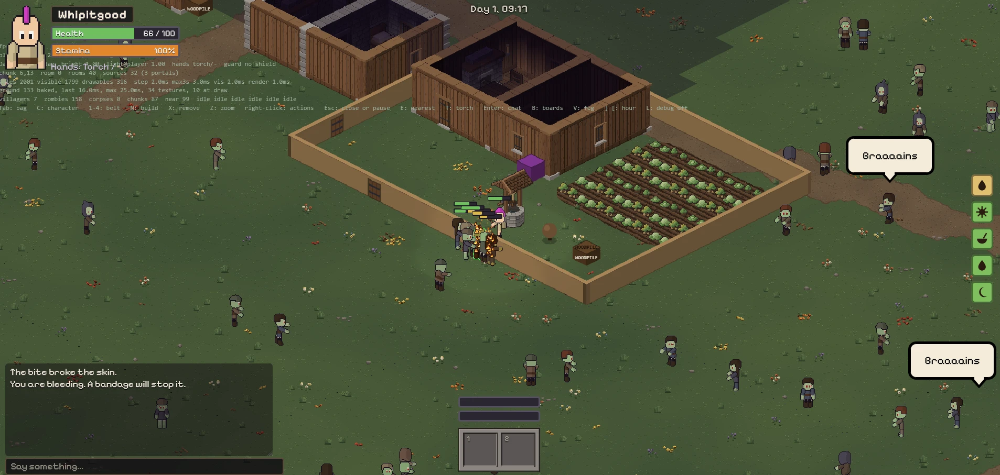

> "I ended up in the above situation with my piddley little torch and all those zombies and was immediately like "oh my god I'm going to die" and then I got a bleed. If not for the invincible fence I would be super dead." (2026-10-16)

Later that night came the roadmap, in order, from the valley and its skills to Steam ("Be realistic, I have never done this before"), and the test for the valley: "it just needs to feel like playing a game, not testing a game." Michael plays with the sound off ("My brother thinks this is horrifying"), so the agents were asked to argue for it: "Be the sound on advocate between us."

The following days were the valley's working parts. A rule for every item in a grid: hover over it and it tells you what it is and what it does ("Edit how an apple works? Check the card too"). Food that heals what it says, "like in OSRS". Tools you must carry, "the OSRS inventory puzzle part of the game which Zomboid does not have, because it uses weight". Michael drafted the skills by hand, levels one to ten, and made death take them ("As of now this is the only true punishment for dying and we need one"). By the evening of 19 October the scoping had worn thin ("I am tired of scoping and it makes my brain hurt"), and the work turned to the fun parts: floating combat text, a navigation row, parchment dialogue.

> "I can't believe dev art can look this good tbh" (2026-10-20)

---

## Demo first, and the feel of a fight (23 to 26 October)

After a two-day break, Michael ruled that the demo would be built on the art the game already had, because it "is the much simpler overall playtest because it's not meant for long term survival or maxxing skills or whatever, it's there to give you a bounded experience of the game."

Melee got a real playtest, and a lesson from Zomboid not to copy: "zomboid is about LOTS of zombies ... we just could not replicate that and call it part cozy game." So the dead got tougher instead, "a bit more bullet spongey so that finding one or two is not a quick knife fight but an endurance test with crappy weapons".

> "The fact that I couldn't help myself and wanted to play more despite being dead tired is a good sign lol." (2026-10-24)

> "I would say in terms of basic mechanics, we are there." (2026-10-24)

Then a Playtest Checklist: a page holding every change since the valley began, Michael's ticks, a note on each, and a box for bug reports the agents read and answer.

---

## Up a storey (26 to 29 October)

### Walls, depth, floors, and towers

On the evening of 26 October a question about wall heights ended in a rebuild of the renderer. Zomboid's rooms are always three crates tall, and Michael liked how readable that made them:

> "If any prop in the game is going to be a measuring stick, make it the perfectly square, perfectly one tile storage crate to match zomboid."

Walls became 96 pixels, three crates. Props kept clipping into them, so: "Is adding a depth buffer an option?" It was, and the renderer was rebuilt to sort every pixel. Upper floors were specified the same evening, as layers, the way Zomboid does it, with stairs that move you to the next layer as you cross their top. And round rooms, drawn first in a paint program:

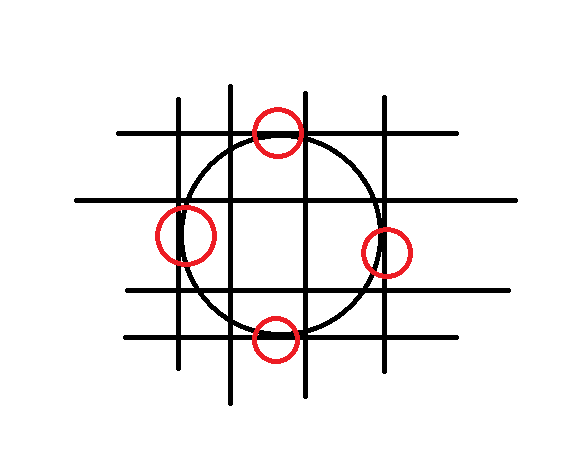
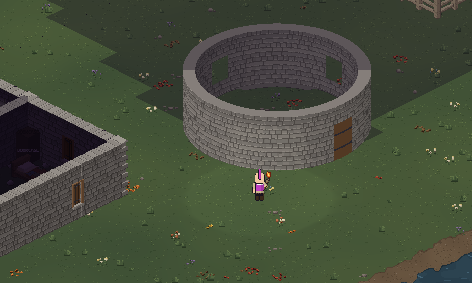

> "circular stone buildings were common in the middle ages: it unlocks real towers, cool castle rooms, small rounded additions" (2026-10-26)

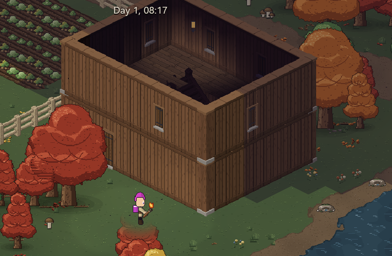

The next evening the game was shown to a friend: "This guy has also not played Zomboid even once though to leading a column of zombies around while backpeddling is still novel to him lol. And he was clearly having fun."

Just after midnight Michael made the villagers' law. They had been killable, then immune if they taught a skill, then all immune unless scripted; now it was final:

> "Let's just make it a rule now: villagers are immune. They run and cower as they do now, they cannot be attacked by zombies. Same reason the NPCs in the grand exchange can't be killed - the game needs them to be there." (2026-10-28)

### The day the map got elevation

This is the story Michael tells to show how the game is made.

At 12:42 in the morning on 28 October, in the middle of a question about how to bound the world, Michael wrote it off:

> "We also have no elevation right now, as I understand it an unfortunate consequence of being a 2d isometric world. Which means no mountains to block off passage like in wow."

Nine minutes later came a change of mind, with a picture of the Motherlode Mine in Old School RuneScape, whose levels are lumpy cliffs:

> "Wait, now that we have stairs and floors, is it possible to build wall and floor pieces that are bare solid rock ... It's just a multistory house with none of it being buildable, destroyable, pass-throuable, etc. ... Then when you don't want the player to go higher, no more stairs. Done."

The agents answered with a plan too clever for the question: ground that could sit at any level, the inside of a hill drawn as solid earth. Michael pushed back ("This is more complicated than I was imagining") and at noon drew what was meant.

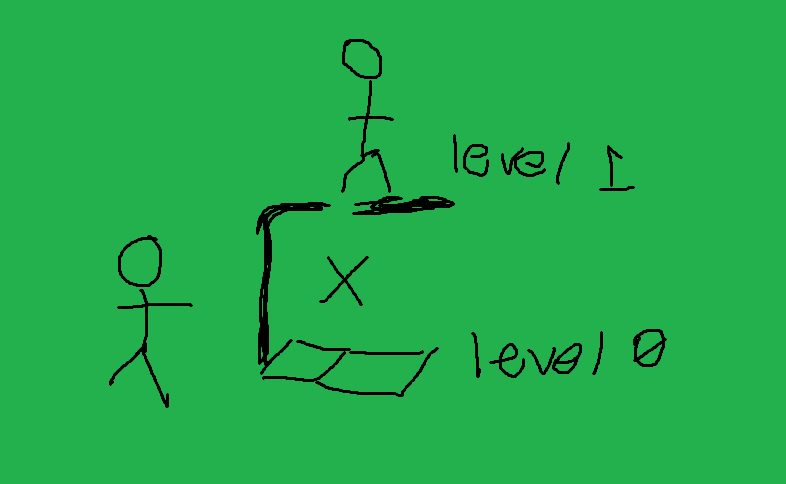

> "Let me illustrate the inside of the hill thing. Again, don't think up any new mechanics, I think all of this can be done with today's tech. Imagine the build tool allowing you to build a wall but instead of wood or stone it's bare grey cliff, rounds at the top corner, and meets up with a tile above to form a cliff face. These two tiles are really no different from a wall and a floor tile on the second floor (level 1). I said the area behind it would be dark because there is no light in there, no entities, just barren ground hidden behind a cliff wall art. Hence, big dark area."

A cliff is a wall and a floor. An hour later Michael approved the cliff art an artist agent had drawn for it, and that afternoon built the first cliff beside the river.

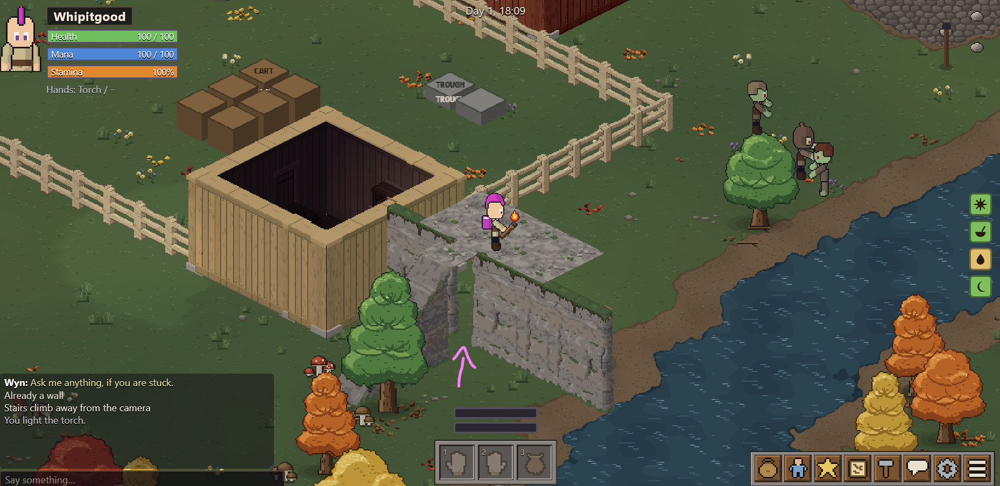

> "Awesome. This is very promising, as far as I can tell, with some care, and these coming with the map and never being built by players, it turns out we actually CAN have real elevation in a 2d isometric game lol" (2026-10-28)

The ramp needed sides; Michael researched how Zomboid's stairs meet a wall and asked for the ramp to bring its own. After midnight, on a flat grass map asked for that evening for building by hand, Michael built a bluff.

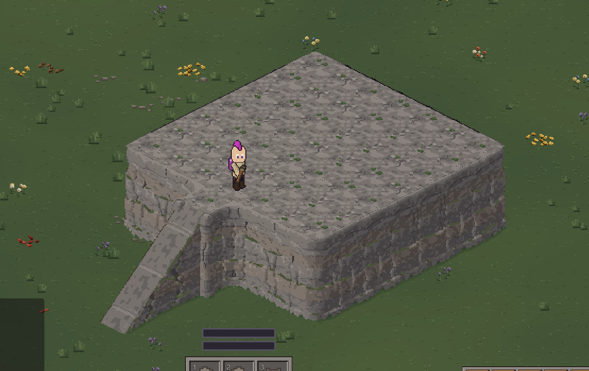
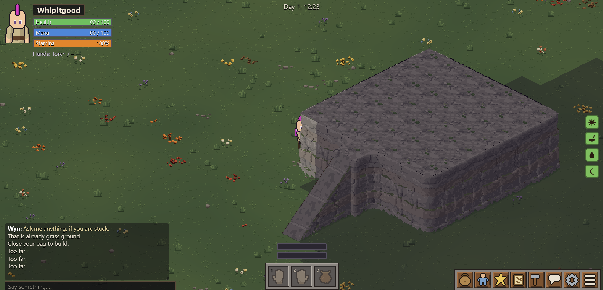

> "Just so you can see how well this is going otherwise,  it was literally yesterday in human time that I told you it was a bummer we couldn't have elevation. And I have built a coherent bluff. I can hide behind it, and the top is shadowed because it's a different level. It's a thing of beauty." (2026-10-29)

Twenty minutes later, a second level on top of it.

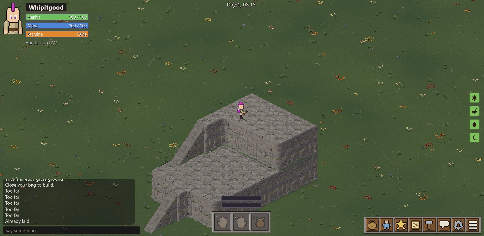

> "Just proving the full second level works."

And forty minutes after that, at night in the game, a hollow in the hill with the fire pit the agents had drawn two days before.

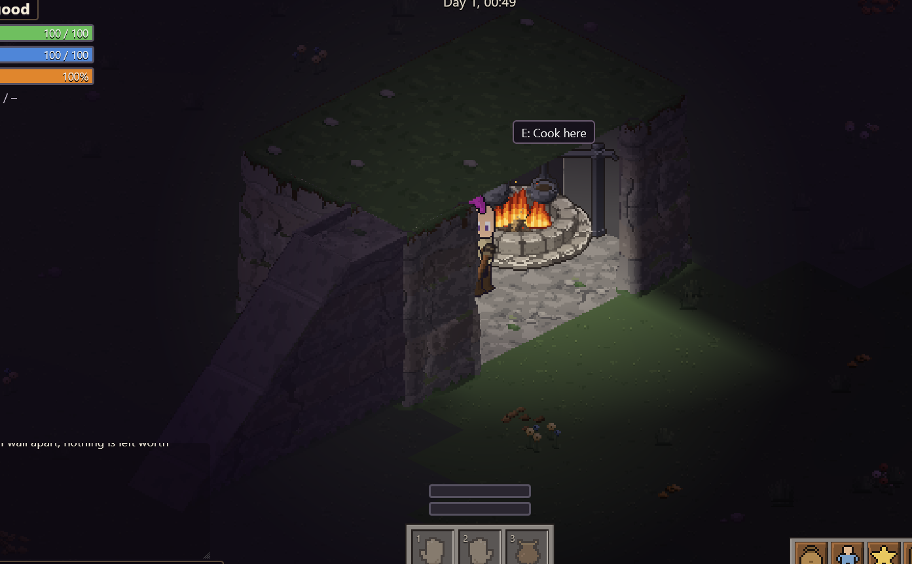

> "Can you add one note to the next session notes? We are a few thoughtful changes away from getting caves for free as well. Perhaps not big ones, it's mostly there already." (2026-10-29)

From "no elevation" to a lit cave took about twenty-five hours, and it needed no new mechanic. Floors, stairs, walls, and light were already there; the cliffs were new art for them, wired in and fixed along the way.

The same night brought castle gates and battlements for a castle Michael wants to build, with a note only a web developer would write ("In CSS terms, I want margin not padding on the battlements box model lol"), and a list of everything the valley needs, place by place, to lay out by hand before the real map is built.

---

## What was tried and thrown away

A history of care is mostly a history of things cut. Each of these was built or ruled, tried, and dropped, and the reason is on record. The decisions log alone holds 141 struck passages.

- **The side-scroller and its digging.** "Not digging specifically I guess, but the vibe." Two dimensions could not give the slow dead room to be outfoxed. The game rules "No cellar dig, only prefabs."
- **The dioramas, and modern guns.** Fake back walls, windows that were "a zombie spawn portal", guns "way too powerful".
- **Glass windows**, from the side-scroller: "It's not medieval, but the rule of what is more fun is more important", Michael said then. This game went back to wooden shutters.
- **Climbing through windows.** Asked for in the game's first days, "just like in zomboid", then made a law against.
- **Cozy by day and siege by night.** "an ancient concept in git commit terms. Kill it, the vision doc basically overwrites this."
- **Killable villagers.** On day one they fled and could die, and "villagers rise as zombies" was "lowkey super compelling". By 28 October: "That's an ancient ruling, so expunge it lol."
- **Lights that never go out.** "never goes out is an ANCIENT ruling, if light attracts zombies, they need to be snuffable."
- **Refusing food when full.** Ruled on 17 October, reversed by a playtest the next day: "It feels unfair to stop you from using it to heal".
- **Habbo and Tirisfal as the look of home.** "I think we have also evolved past Habbo as a visual reference. That and Tirisfal are ANCIENT ideas in the lifespan of this game". The gloom belongs to the far regions now.
- **A hand-drawn wordmark**, replaced twelve minutes later by a font. The only real revert in the history.
- **An endless wild.** The map grew forest forever at its edges; on 28 October it became bounded, full stop, so a far region can never be seen from behind: "It must be a bounded map."

---

## The games behind it

Michael names influences constantly, and what is taken from each is specific. Michael's own summary, written for this page:

> "Zomboid the primary inspiration which is the melee mechanics, harshness of the survival mechanics, sandbox interest, world tech (chunking, layering), days survived clock, death makes you get up and walk around and you can kill and loot your own corps thing, etc. OSRS my inspo for skilling and production chains that feel natural and also the right click -> Use model, and NPCs and their immunity and importance. WoW my 21 year game which comes out in some of the world design, the "zones", how I want the bosses to work, some of the art where I keep insisting that warcraft exaggerating its models proportions is probably good actually in pixel art rather than realism." (2026-10-29)

- **Project Zomboid**: the line of sight, the melee, the layers, the three-crate rooms. And as often, what to refuse: the water shutoff, world decay, muscle strain, "you are not clearing entire new blocks every day".
- **Old School RuneScape**: "OSRS does production chain busywork better than any game I have ever played." The wiki, the inventory puzzle, the Use mode, "nothing interesting happens", the Motherlode Mine.
- **World of Warcraft**: zones, bosses, floating combat text, exaggerated proportions, and Tirisfal Glades as the first palette for the gloom.
- **Stardew Valley**: the cosy start, "start as stardew", farming that must be fun or the game is not.
- **Minecraft and Terraria**: the bow, the hotbar, the stone interface, and the side-scroller that taught what 2D cannot do.

---

## How it is made

- **Michael rules; agents build.** Michael scopes with one model and builds with another. Agents write the code, in plain JavaScript with no engine, and draw the art in rounds Michael approves or sends back. No agent changes a ruling.
- **Every ruling is logged with its reason**, newest first, most in Michael's own words. An overturned ruling is struck where it sits, naming what overturned it.
- **Every change is built for a friend in the same world**, and checked in two browser tabs before it is called done.
- **Every change is reviewed**, as a rule by an agent that had no part in it, and merged only by the Primary. About a third of the pull requests were sent back at least once. One review of the item cards blocked a merge because "some cards say things that are not true, and that is the one thing the law is about."
- **The wiki is part of shipping.** Nothing that changes the game is done until its wiki page says so.
- **Michael plays it.** Many of the bugs on record were found by eye: a stair's walkable band half a tile off its drawing, lit furniture shapes bleeding through a wall, the dead hitting a fence door left open.

---

## The numbers

Three weeks of this game, from the first commit on 8 October to 29 October 2026. Nothing happened on 21 and 22 October.

| | |
|---|---|
| Commits | 1,843 |
| Pull requests merged (from 15 October) | 343 |
| Pull requests sent back at least once, then approved | about 93 |
| Dated entries in the decisions log | 282 |
| Struck passages in the decisions log | 141 |
| Messages from Michael to the agents | about 1,000 |
| Pictures Michael sent the agents | 163 |
| Lines of game code (`src`) | 48,349 |
| Lines of code in all, with the server and the tools | about 108,800 |
| Drawn pictures in the game's art | 1,082 |
| Items | 146 |
| Wiki pages | 289 |

By day:

| Day | Commits | Pull requests merged | Rulings logged | Game code at day's end |
|---|---|---|---|---|
| 10-08 | 5 | | 1 | 2,679 |
| 10-09 | 53 | | 3 | 8,483 |
| 10-10 | 36 | | 10 | 11,788 |
| 10-11 | 85 | | 35 | 15,020 |
| 10-12 | 84 | | 53 | 18,440 |
| 10-13 | 94 | | 24 | 22,466 |
| 10-14 | 60 | | 12 | 24,156 |
| 10-15 | 59 | 18 | 16 | 24,415 |
| 10-16 | 123 | 29 | 8 | 25,035 |
| 10-17 | 334 | 69 | 8 | 28,920 |
| 10-18 | 26 | 8 | 30 | 28,920 |
| 10-19 | 86 | 20 | 16 | 30,124 |
| 10-20 | 88 | 31 | 14 | 31,900 |
| 10-23 | 42 | 10 | 4 | 31,930 |
| 10-24 | 80 | 22 | 6 | 33,034 |
| 10-25 | 257 | 55 | 15 | 40,241 |
| 10-26 | 94 | 20 | 12 | 41,908 |
| 10-27 | 167 | 33 | 6 | 46,641 |
| 10-28 | 30 | 11 | 5 | 47,449 |
| 10-29 | 40 | 17 | 4 | 48,349 |

How these were counted: commits on `main` by author date in Michael's time zone, merges included; pull requests from GitHub, where the work moved on 15 October; rulings as the dated headings in `docs/02-decisions.md`, which sometimes uses the UTC day, so a ruling and its commit can fall on neighbouring days. Sent-back reviews are counted by matching each review's verdict line, so the figure is approximate. Messages and pictures are counted from the session transcripts since 8 October; some messages carry another agent's report that Michael passed along by hand.
